<div align="center">

<picture>
  <source media="(prefers-color-scheme: light)" srcset="docs/art/banner-en-light.svg">
  
</picture>

**English** · [Türkçe](README.tr.md) · [Website](https://sweax3169.github.io/sweaxdrop/) · [Download](https://github.com/Sweax3169/sweaxdrop/releases/latest)

[](https://github.com/Sweax3169/sweaxdrop/actions/workflows/build.yml)


</div>

SweaxDrop moves files, photos, videos, folders, text and the clipboard between your
PC and your phones over your own network. Devices find each other by themselves,
every transfer is encrypted with TLS 1.3 and checked chunk by chunk, and when the
Wi-Fi drops it carries on from the last verified chunk instead of starting over.

It runs on Windows, Android and iPhone from one Rust core and one interface. An
iPhone without the app can use it right away: scan the QR code on the PC and the
browser becomes the app.

<div align="center">
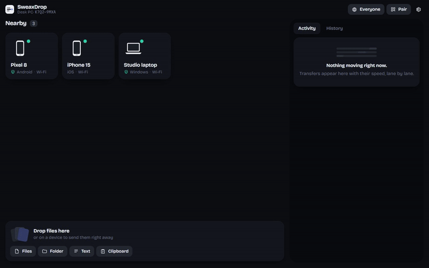
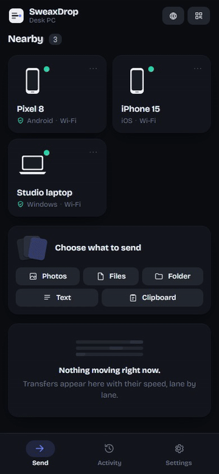
</div>

## Contents

[Measured against LocalSend](#measured-against-localsend) ·
[What it does](#what-it-does) ·
[How it is fast](#how-it-is-fast) ·
[Security](#security) ·
[Install](#install) ·
[iPhone](#iphone) ·
[Using it](#using-it) ·
[Compared with other tools](#compared-with-other-tools) ·
[Build from source](#build-from-source) ·
[Project layout](#project-layout) ·
[FAQ](#faq)

## Measured against LocalSend

LocalSend is the most popular open-source tool of this kind, so it is the one to
beat. Both programs ran on the same PC, sent the same files to themselves over the
same network path and wrote them to the same NVMe drive. LocalSend is the official
1.18.2 command-line app, driven through a terminal so it accepts the request the
moment it appears. Every number is the median of four runs, measured by
[`sweaxdrop-bench`](crates/bench) and [`tools/localsend_bench.py`](tools/localsend_bench.py);
the raw results are in [`bench/results`](bench/results) and the method in
[docs/benchmarks.md](docs/benchmarks.md).

<!-- BENCH:START -->
| Files | SweaxDrop 1.0.0 | LocalSend 1.18.2 (CLI) | LocalSend 1.18.2 (protocol sender) | SweaxDrop is |
|---|---|---|---|---|
| One 4 GiB file | **13.57 s** | 13.56 s | 10.50 s (1 run) | about the same |
| 200 photos, 723 MB | **0.64 s** | 3.08 s | — | **4.8× faster** |
| 10 000 small files, 338 MB | **5.24 s** | — | 15.62 s | **3.0× faster** |
| 300 small files | **0.13 s** | 1.67 s | 0.43 s | **3.4× faster** |
<!-- BENCH:END -->

<picture>
  <source media="(prefers-color-scheme: light)" srcset="docs/art/bench-en-light.svg">
  
</picture>

What these numbers are, and are not:

* **One 4 GiB file ties.** Both programs wrote it as fast as this SSD would take
  it, and the SSD (95% full) is what varied: runs of both ranged from 6 to 27
  seconds. With the disk out of the way SweaxDrop moves 3 GB/s on four lanes
  ([network path](docs/benchmarks.md#tcp-or-quic)); LocalSend cannot be measured
  without its disk.
* **Many files is where the design shows.** One request per file, two files at a
  time and a SHA-256 pass before sending cost LocalSend 3 to 5 times longer on
  photos and small files.
* LocalSend's own command-line sender cannot take 10 000 paths, so those runs use
  a sender that speaks LocalSend's protocol the way LocalSend 1.18 does (two
  uploads at a time, no hashing first). Where both senders could run, both are
  shown, and the difference is computed against the faster one.
* They show **how much each program can move** with the radio out of the way.
  Over Wi-Fi, one big file is limited by the air for both programs: a 2×2 Wi-Fi 6
  phone reaches roughly 100 MB/s on an 80 MHz channel, and about half of that when
  both devices are on Wi-Fi behind the same router, because every byte crosses the
  air twice ([research](docs/research.md#10-physical-limits)).
* The differences that survive on Wi-Fi are the ones not caused by raw speed: no
  request per file, starting at once instead of hashing everything first, and
  resuming instead of restarting.
* Phone numbers over real Wi-Fi need real phones and are added to
  [docs/benchmarks.md](docs/benchmarks.md) as they are measured. The Android
  emulator was used to check that transfers work in both directions and arrive
  byte-identical (SHA-256), not for speed: its virtual network is slow.

## What it does

<table>
<tr>
<td width="33%" valign="top">

**Everything you'd send**<br>
Files, whole folders with their structure, photos and videos from the gallery,
text, links and the clipboard. Received photos go to the gallery on phones.

</td>
<td width="33%" valign="top">

**Parallel lanes**<br>
Up to 16 encrypted lanes at once (4 by default). The cards in the app draw the
real lanes: each track moves as fast as its connection moves bytes.

</td>
<td width="33%" valign="top">

**Resumes**<br>
Lose the Wi-Fi in the middle of a 4 GB video and only the missing 4 MiB chunks
travel again. Pause and resume from either side; transfers to one device queue.

</td>
</tr>
<tr>
<td valign="top">

**Pairs for good**<br>
Pair once with a six-digit PIN or a QR code. Paired devices can send without a
prompt and are refused if their key ever changes.

</td>
<td valign="top">

**No app? No problem**<br>
The PC serves the same interface to any phone browser. Scan the code, send
photos up, download files, save pictures to Photos.

</td>
<td valign="top">

**Looks back**<br>
History with the speed curve of every transfer, totals sent and received, the
fastest run, and the folder each file went to.

</td>
</tr>
<tr>
<td valign="top">

**Windows**<br>
Tray icon, drag and drop from Explorer onto a device, *Send to → SweaxDrop*,
notifications, start with Windows, close to tray.

</td>
<td valign="top">

**Android**<br>
*Share → Send with SweaxDrop* from any app, photo picker, folders, a save folder
of your choice, a progress notification, optional "stay ready in the background".

</td>
<td valign="top">

**Yours to tune**<br>
Receive from everyone, only paired devices, or nobody. Lanes, chunk size, TCP or
QUIC, AES or ChaCha20. Light, dark, five palettes, English and Turkish.

</td>
</tr>
</table>

<div align="center">
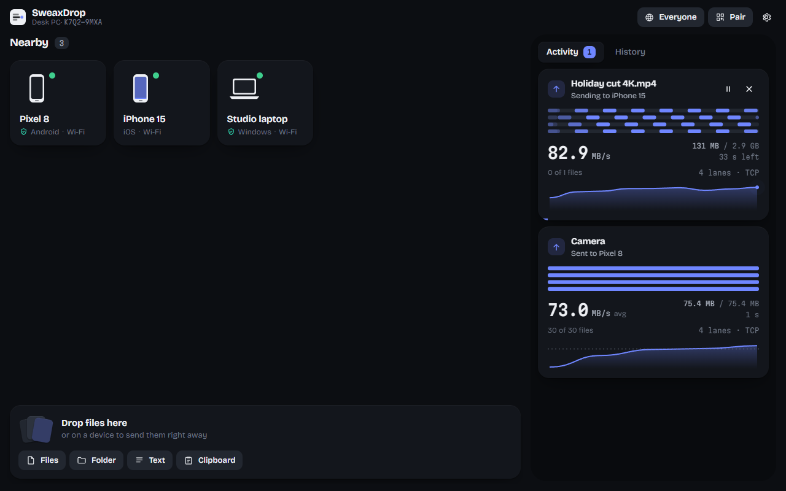
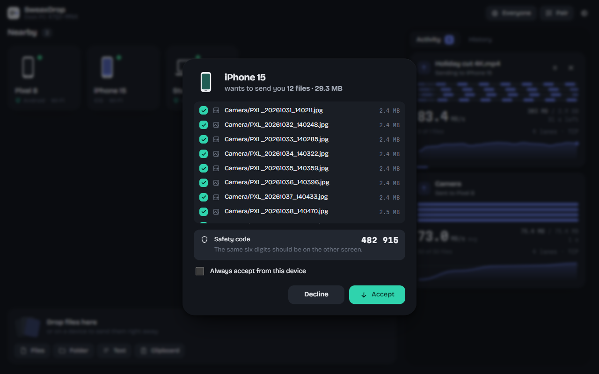
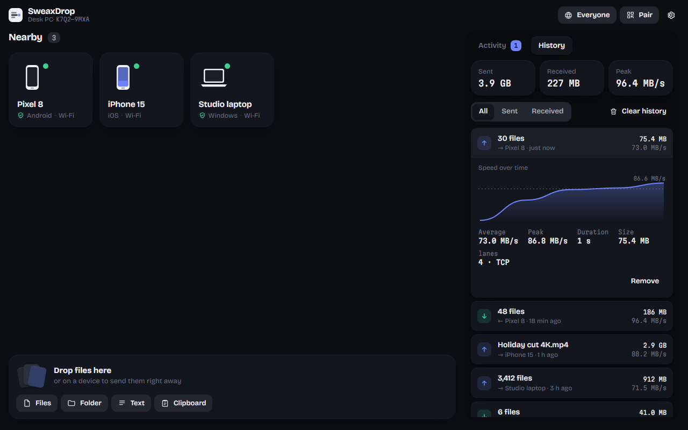
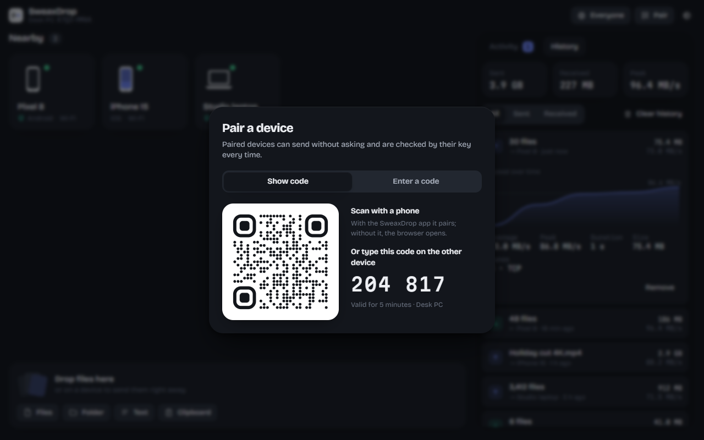
</div>

<div align="center">
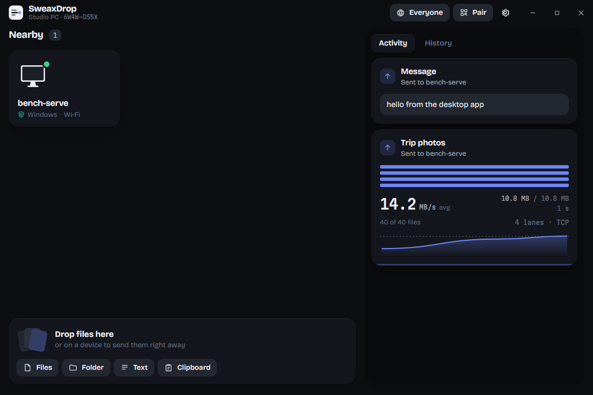
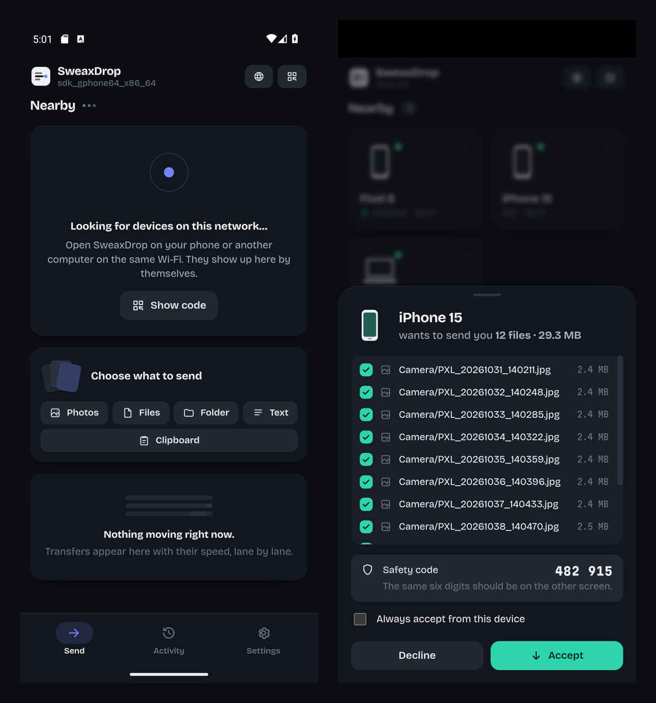
<br><sub>The real apps: the Windows release build, driven by <code>tools/smoke-desktop.mjs</code>, and the Android build on the emulator. The speed on that card is a cold first run of 40 small photos into a fresh folder, not a benchmark; the measured numbers are <a href="#measured-against-localsend">above</a>.</sub>
</div>

## How it is fast

<picture>
  <source media="(prefers-color-scheme: light)" srcset="docs/art/lanes-en-light.svg">
  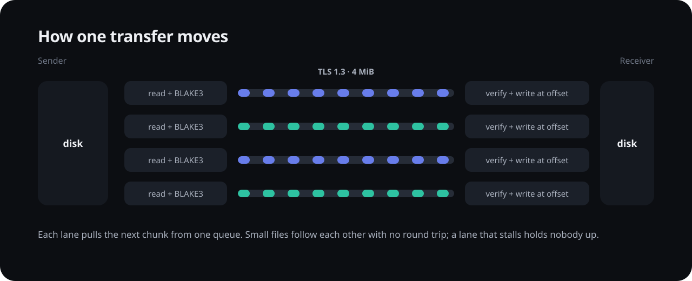
</picture>

* **No request per file.** The sender makes one offer for everything, then streams
  chunks. Small files follow each other on a lane without waiting for any answer.
  Request-per-file designs pay a round trip, a request header and a response for
  every photo.
* **One queue, many lanes.** Each lane is its own TLS 1.3 connection (its own TCP
  congestion window) and takes the next chunk from a shared queue, so a big file
  is spread over all lanes and a slow lane never holds the others up.
* **Nothing waits for anything else.** On each lane a reader thread reads and
  hashes the next chunk while the network task encrypts and sends the previous
  one; on the receiver a writer thread hashes and writes at the chunk's offset
  while the next one is decrypted. Closing and renaming finished files (where
  antivirus scanners make you wait) runs on a separate pool.
* **Integrity without a second pass.** BLAKE3 runs on each chunk as it streams, at
  several GB/s per core. There is no "hash the whole file first" step before the
  transfer starts.
* **Measured choices.** QUIC is built in, but on Windows it reached about 200 MB/s
  with five times the CPU of TCP on the same loopback test, so TCP lanes are the
  default ([numbers](docs/benchmarks.md#tcp-or-quic)). AES-128-GCM goes first
  because PCs and ARMv8 phones have AES instructions; ChaCha20 is a setting.

<picture>
  <source media="(prefers-color-scheme: light)" srcset="docs/art/architecture-en-light.svg">
  
</picture>

## Security

* **Identity is a key.** Every installation makes an Ed25519 key. Its device id
  (`K7Q2-9MXA-L4TB-N8ZE`) is derived from the key, so another device cannot claim
  it: the id is checked against the key proven in the TLS handshake.
* **TLS 1.3 both ways.** Both sides present their certificate. Paired devices are
  pinned; if a paired id shows up with a different key, nothing is sent. Discovery
  packets are never trusted, they only say where to connect.
* **Pairing that a relay cannot fake.** PIN pairing runs SPAKE2 over the TLS
  connection and then proves the shared key with a MAC over *both* TLS
  fingerprints. Someone relaying the connection sees different keys on each side,
  so the MACs cannot match. A wrong PIN can be tried online only, five times.
  QR pairing carries the showing device's fingerprint and a one-time secret.
* **Before the first transfer** from an unpaired device, both screens can show a
  six-digit safety code to compare.
* **Checked on arrival.** Every chunk is verified (BLAKE3) before it is written.
  Paths from the network are cleaned: no `..`, no drive letters, no names Windows
  reserves.
* **The browser client is the exception.** Browsers cannot accept the PC's
  self-signed certificate without a warning page, so this path is plain HTTP on
  your network, guarded by the 128-bit secret in the QR code and per-session
  tokens. Turn it off in Settings if you do not need it.
* **Nothing leaves your network.** No account, no relay server, no telemetry.

The full protocol is in [docs/protocol.md](docs/protocol.md).

## Install

### Windows 10 and 11

1. Download `SweaxDrop-1.0.0-Windows-Setup.exe` from the
   [latest release](https://github.com/Sweax3169/sweaxdrop/releases/latest).
2. Run it. Windows asks once for administrator rights (UAC): the installer adds
   one inbound firewall rule for `sweaxdrop.exe` so phones can reach it, and the
   uninstaller removes it. The app itself never touches firewall settings.
3. SmartScreen may warn because the installer is not code-signed. Choose
   *More info → Run anyway* if the file came from this repository's releases
   (compare it with `SHA256SUMS.txt`).

After installing, *Send to → SweaxDrop* appears in Explorer's right-click menu.

### Android 10 and newer

1. On the phone, download `SweaxDrop-1.0.0-Android.apk` from the
   [latest release](https://github.com/Sweax3169/sweaxdrop/releases/latest).
2. Open it. Android asks to allow installing apps from your browser; allow it for
   this install.
3. Open SweaxDrop and allow notifications (progress and incoming files).

## iPhone

### Right away, nothing to install

1. Open SweaxDrop on your PC and click **Pair** (or the QR code in the empty list).
2. Point the iPhone camera at the QR code and tap the link.
3. Safari opens SweaxDrop. Send photos and files to the PC, or receive what the PC
   sends. To keep a received photo, touch and hold it, then *Save to Photos*.
   Other files go to the Files app.

### The native app

Apple only lets apps onto an iPhone that are signed for that device, and signing
needs an Apple ID. This repository's CI builds the app on a macOS runner without
signing (`SweaxDrop-1.0.0-iOS-unsigned.ipa`); you sign and install it with your own
Apple ID through a sideloading tool. Your Apple ID and password are typed only into
Apple's sign-in inside that tool, on your own PC.

**With a free Apple ID** (the app expires after 7 days and must be refreshed; at
most 3 sideloaded apps):

1. On your PC install [AltServer](https://altstore.io) (it needs iTunes and iCloud
   for Windows from Apple's website, not the Microsoft Store versions), or use
   [Sideloadly](https://sideloadly.io).
2. Connect the iPhone with a cable and trust the computer.
3. **AltStore:** install AltStore on the phone from AltServer's tray menu, then
   open the `.ipa` in AltStore. **Sideloadly:** drag the `.ipa` into Sideloadly and
   press Start.
4. On the iPhone: *Settings → General → VPN & Device Management*, trust your Apple
   ID's developer profile. On iOS 16 and newer also turn on
   *Settings → Privacy & Security → Developer Mode* and restart.
5. Refresh the app before 7 days pass (AltStore can do it over Wi-Fi).

**With a paid Apple Developer account** (99 USD a year) the same tools sign for a
year, and the project can be built and installed straight from Xcode on a Mac
(`apps/ios/project.yml`, generated with XcodeGen).

On first start the app asks for *Local Network* access (to find the PC) and, when
you receive photos, permission to add them to your library.

## Using it

* **Send:** drag files onto a device, or pick files, a folder, photos, text or the
  clipboard and click a device. On Android, *Share → Send with SweaxDrop* from any
  app. On Windows, *Send to → SweaxDrop* in Explorer.
* **Receive:** a sheet shows who is sending what, with a safety code for unpaired
  devices. Untick files you do not want, choose another folder, or tick *Always
  accept from this device*.
* **Pair:** *Pair → Show code* on one device, *Enter a code* (or scan it) on the
  other. Paired devices show a shield.
* **No device in the list?** Both must be on the same network. *Pair → Enter a code
  → Add by address* connects by IP. A phone hotspot or USB tethering works too.
* **Settings:** receive from everyone, paired devices only, or nobody; save folder;
  auto-accept for paired devices; copy received text to the clipboard; the browser
  client; start with Windows; lanes, chunk size, transport, cipher; theme, colors,
  language.

## Compared with other tools

From [docs/research.md](docs/research.md), where each cell has its source.

| | SweaxDrop | LocalSend 1.18 | KDE Connect | Warpinator | PairDrop | Quick Share | croc |
|---|---|---|---|---|---|---|---|
| Transport | TCP lanes, TLS 1.3 (QUIC optional) | HTTPS, one request per file | TCP + TLS, a new connection per file | gRPC over TLS | WebRTC data channel | protobuf over TCP, upgrades to hotspot / Wi-Fi Direct | TCP, relay or direct |
| In flight at once | chunks of any file on up to 16 lanes | 2 files | 1 file | 1 file | 1 file, ack every 1 MB | 1 payload | chunks of 1 file on up to 4 connections |
| Resume after a drop | yes, from the last verified chunk | no, the file restarts | not found | no, partial files deleted | not found | not found in the app | yes |
| Who is on the other end | key proven in TLS, pinned after pairing | fingerprint pinned at discovery | pinned after pairing | shared group code (default "Warpinator") | signaling server is trusted | UKEY2 + 4-digit PIN | code phrase (PAKE) |
| Hash before the transfer starts | no, per chunk while streaming | yes, SHA-256 of every file | no | no | no | no | no |
| Phone without the app | browser client from the PC | web share link | no | no | is a website | no | no |

## Build from source

You need Rust (stable), Node.js 20+, and each platform's SDK.

```bash
git clone https://github.com/Sweax3169/sweaxdrop && cd sweaxdrop
cd ui && npm ci && npx vite build && cd ..          # the shared interface
cargo test -p sweaxdrop-core                        # transfers, resume, pairing
```

* **Windows:** `cd apps/desktop && npm ci && npx tauri build` → `target/release/bundle/nsis/`
* **Android:** with the NDK installed,
  `cargo ndk -t arm64-v8a -t x86_64 -P 29 -o apps/android/app/src/main/jniLibs build --release -p sweaxdrop-ffi`,
  then `cd apps/android && ./gradlew assembleRelease`
* **iPhone (on a Mac):** `cargo build --release --target aarch64-apple-ios -p sweaxdrop-ffi`,
  copy `libsweaxdrop.a` to `apps/ios/lib` and `ui/dist` to `apps/ios/ui`, then
  `cd apps/ios && xcodegen generate` and open `SweaxDrop.xcodeproj`
  ([CI does the same](.github/workflows/build.yml)).
* **Benchmarks:** `cargo build --release -p sweaxdrop-bench`, then
  `sweaxdrop-bench matrix` or `tools/run_benchmarks.sh`.

## Project layout

```
crates/core     the protocol: identity, TLS, discovery, pairing, lanes, resume, browser client
crates/ffi      the core as a library for Android (JNI) and iOS (C ABI)
crates/bench    sweaxdrop-bench: loopback, device and LocalSend measurements
apps/desktop    Windows app (Tauri 2): tray, Send to, drag and drop, installer hooks
apps/android    Android app (Kotlin): WebView host, MediaStore, share target, service
apps/ios        iPhone app (Swift): WKWebView host, Photos, Files, Bonjour
ui              the interface every platform shows (Svelte 5)
docs            website, protocol, research, benchmarks, artwork
tools           media recorder, benchmark drivers, artwork generator
```

## FAQ

**Does it need internet?** No. Everything happens on your local network.

**Why not just use LocalSend?** It is a good tool. SweaxDrop exists to be faster
where LocalSend's design costs time (a request per file, two files in flight,
hashing everything before starting, no resume) and to pin devices by key. See
[the numbers](#measured-against-localsend).

**Does it work through a phone hotspot or a USB cable?** Yes. Any network both
devices share works; USB tethering and hotspot addresses are preferred when a
device can be reached more than one way.

**Where do received files go?** Windows: `Downloads\SweaxDrop` or the folder you
choose. Android: photos and videos to the gallery (`Pictures/SweaxDrop`,
`Movies/SweaxDrop`), everything else to `Download/SweaxDrop`, or a folder you pick.
iPhone: Photos, and the Files app under *On My iPhone › SweaxDrop*.

**Can two PCs use it?** Yes, any two devices running SweaxDrop.

## License

MIT, see [LICENSE](LICENSE). Fonts: Bricolage Grotesque and Martian Mono (SIL Open
Font License). Third-party crates and packages keep their own licenses; see
[THIRD_PARTY_NOTICES.md](THIRD_PARTY_NOTICES.md).

Made by [Sweax Studios](https://github.com/Sweax3169).
