<div align="center">

<picture>
  <source media="(prefers-color-scheme: light)" srcset="docs/art/banner-tr-light.svg">
  
</picture>

[English](README.md) · **Türkçe** · [Web sitesi](https://sweax3169.github.io/sweaxdrop/) · [İndir](https://github.com/Sweax3169/sweaxdrop/releases/latest)

[](https://github.com/Sweax3169/sweaxdrop/actions/workflows/build.yml)


</div>

SweaxDrop; dosyaları, fotoğrafları, videoları, klasörleri, metni ve panoyu kendi
ağın üzerinden bilgisayarınla telefonların arasında taşır. Cihazlar birbirini
kendiliğinden bulur, her aktarım TLS 1.3 ile şifrelenir ve parça parça doğrulanır;
Wi-Fi koparsa baştan başlamaz, son doğrulanan parçadan devam eder.

Windows, Android ve iPhone'da tek bir Rust çekirdeği ve tek bir arayüzle çalışır.
Uygulaması olmayan bir iPhone da hemen kullanabilir: PC'deki QR kodu okut, tarayıcı
uygulamanın kendisi olur.

<div align="center">
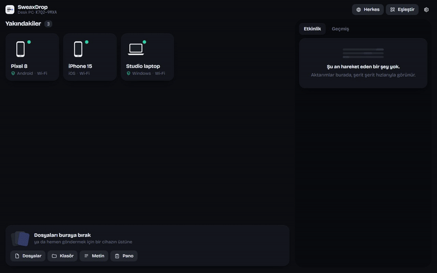
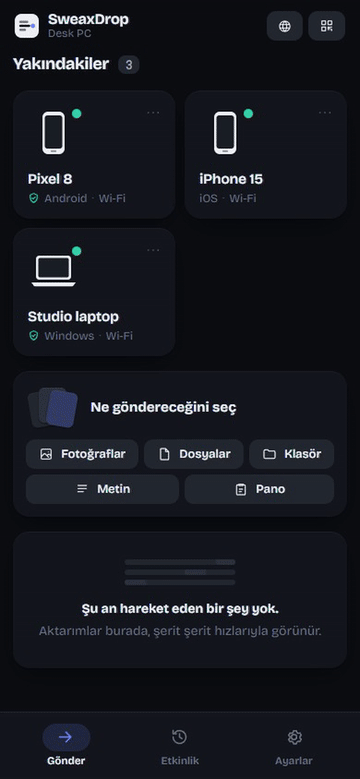
</div>

## İçindekiler

[LocalSend'e karşı ölçüm](#localsende-karşı-ölçüm) ·
[Neler yapar](#neler-yapar) ·
[Neden hızlı](#neden-hızlı) ·
[Güvenlik](#güvenlik) ·
[Kurulum](#kurulum) ·
[iPhone](#iphone) ·
[Kullanım](#kullanım) ·
[Diğer araçlarla karşılaştırma](#diğer-araçlarla-karşılaştırma) ·
[Kaynaktan derleme](#kaynaktan-derleme) ·
[Proje yapısı](#proje-yapısı) ·
[SSS](#sss)

## LocalSend'e karşı ölçüm

LocalSend bu türün en yaygın açık kaynak aracı; geçilmesi gereken o. İki program da
aynı PC'de çalıştı, aynı dosyaları aynı ağ yolundan kendine gönderdi ve aynı NVMe
sürücüye yazdı. LocalSend, resmî 1.18.2 komut satırı uygulaması; istek ekrana
düştüğü an kabul etmesi için bir terminal üzerinden sürüldü. Her sayı dört ölçümün
ortancası; ölçenler [`sweaxdrop-bench`](crates/bench) ve
[`tools/localsend_bench.py`](tools/localsend_bench.py). Ham sonuçlar
[`bench/results`](bench/results) içinde, yöntem [docs/benchmarks.md](docs/benchmarks.md)'de.

<!-- BENCH:START -->
| Dosyalar | SweaxDrop 1.0.0 | LocalSend 1.18.2 (CLI) | LocalSend 1.18.2 (protokol göndericisi) | SweaxDrop |
|---|---|---|---|---|
| Tek 4 GiB dosya | **13,57 sn** | 13,56 sn | 10,50 sn (1 ölçüm) | yaklaşık aynı |
| 200 fotoğraf, 723 MB | **0,64 sn** | 3,08 sn | — | **4,8 kat hızlı** |
| 10 000 küçük dosya, 338 MB | **5,24 sn** | — | 15,62 sn | **3,0 kat hızlı** |
| 300 küçük dosya | **0,13 sn** | 1,67 sn | 0,43 sn | **3,4 kat hızlı** |
<!-- BENCH:END -->

<picture>
  <source media="(prefers-color-scheme: light)" srcset="docs/art/bench-tr-light.svg">
  
</picture>

Bu sayılar neyi gösterir, neyi göstermez:

* **Tek 4 GiB dosyada berabere.** İki program da dosyayı bu SSD'nin kabul ettiği
  hızda yazdı; değişen SSD'ydi (%95 dolu): ikisinin ölçümleri de 6 ile 27 saniye
  arasında oynadı. Disk aradan çıkınca SweaxDrop dört şeritte 3 GB/s taşıyor
  ([ağ yolu](docs/benchmarks.md#tcp-or-quic)); LocalSend diski olmadan ölçülemiyor.
* **Fark çok dosyada ortaya çıkıyor.** Dosya başına bir istek, aynı anda iki dosya
  ve göndermeden önce SHA-256 turu, fotoğraflarda ve küçük dosyalarda LocalSend'e
  3 ila 5 kat daha uzun sürdürüyor.
* LocalSend'in kendi komut satırı göndericisi 10.000 yol alamıyor; bu ölçümlerde
  LocalSend'in protokolünü LocalSend 1.18 gibi konuşan bir gönderici kullanıldı
  (aynı anda iki yükleme, önceden hash yok). İki gönderici de çalışabildiğinde ikisi
  de gösterildi ve fark hızlı olana göre hesaplandı.
* **Her programın ne kadar taşıyabildiğini** gösterir; radyo devre dışıyken.
  Wi-Fi'da tek büyük dosyada iki programın da sınırı havadır: 2×2 Wi-Fi 6 bir
  telefon 80 MHz kanalda yaklaşık 100 MB/s'ye çıkar; iki cihaz da aynı modemin
  arkasında Wi-Fi'dayken bunun yaklaşık yarısına, çünkü her bayt havayı iki kez
  geçer ([araştırma](docs/research.md#10-physical-limits)).
* Wi-Fi'da da kalan farklar ham hızdan gelmeyenlerdir: dosya başına istek yok,
  önce her şeyi hash'lemek yerine hemen başlamak, baştan başlamak yerine kaldığı
  yerden sürmek.
* Gerçek Wi-Fi'da telefon sayıları gerçek telefon ister; ölçüldükçe
  [docs/benchmarks.md](docs/benchmarks.md)'ye eklenir. Android emülatörü hız için
  değil, aktarımın iki yönde çalıştığını ve dosyaların bayt bayt aynı (SHA-256)
  geldiğini doğrulamak için kullanıldı: sanal ağı yavaştır.

## Neler yapar

<table>
<tr>
<td width="33%" valign="top">

**Göndereceğin her şey**<br>
Dosyalar, yapısıyla birlikte klasörler, galeriden fotoğraf ve videolar, metin,
bağlantılar ve pano. Telefonda gelen fotoğraflar galeriye gider.

</td>
<td width="33%" valign="top">

**Paralel şeritler**<br>
Aynı anda 16'ya kadar şifreli şerit (varsayılan 4). Uygulamadaki kartlar gerçek
şeritleri çizer: her iz kendi bağlantısı ne kadar bayt taşıyorsa o hızda akar.

</td>
<td width="33%" valign="top">

**Kaldığı yerden**<br>
4 GB'lık bir videonun ortasında Wi-Fi giderse yalnız eksik 4 MiB'lık parçalar
yeniden gider. İki taraftan da duraklat ve sürdür; aynı cihaza aktarımlar sıraya
girer.

</td>
</tr>
<tr>
<td valign="top">

**Bir kez eşleş**<br>
Altı haneli PIN ya da QR kodla bir kez eşleş. Eşleşen cihazlar sormadan
gönderebilir; anahtarları bir gün değişirse reddedilir.

</td>
<td valign="top">

**Uygulama yok mu? Sorun değil**<br>
PC aynı arayüzü herhangi bir telefon tarayıcısına sunar. Kodu okut, fotoğrafları
yükle, dosyaları indir, resimleri Fotoğraflar'a kaydet.

</td>
<td valign="top">

**Geriye bakar**<br>
Her aktarımın hız eğrisiyle geçmiş, gönderilen ve alınan toplamlar, en hızlı
aktarım ve her dosyanın gittiği klasör.

</td>
</tr>
<tr>
<td valign="top">

**Windows**<br>
Tepsi simgesi, Gezgin'den bir cihazın üstüne sürükle-bırak, *Gönder → SweaxDrop*,
bildirimler, Windows ile başlat, kapatınca tepside kal.

</td>
<td valign="top">

**Android**<br>
Her uygulamadan *Paylaş → SweaxDrop ile gönder*, fotoğraf seçici, klasörler,
istediğin kayıt klasörü, ilerleme bildirimi, isteğe bağlı "arka planda almaya
hazır kal".

</td>
<td valign="top">

**Sana göre ayarlanır**<br>
Herkesten, yalnız eşleşenlerden ya da kimseden alma. Şerit sayısı, parça boyutu,
TCP ya da QUIC, AES ya da ChaCha20. Açık, koyu, beş renk paleti, Türkçe ve
İngilizce.

</td>
</tr>
</table>

<div align="center">
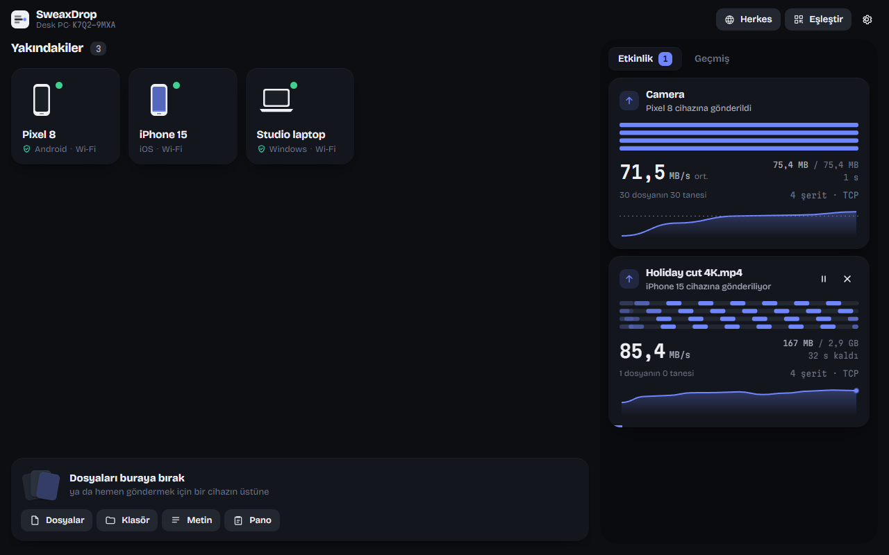
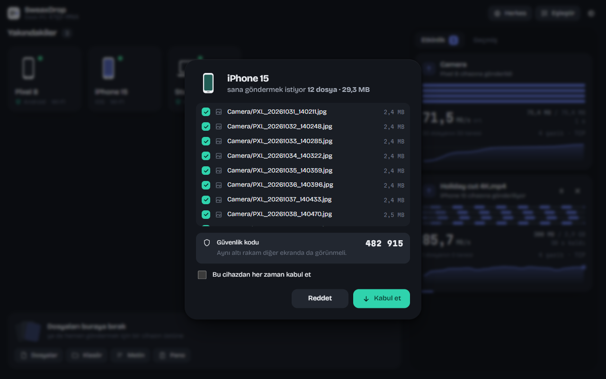
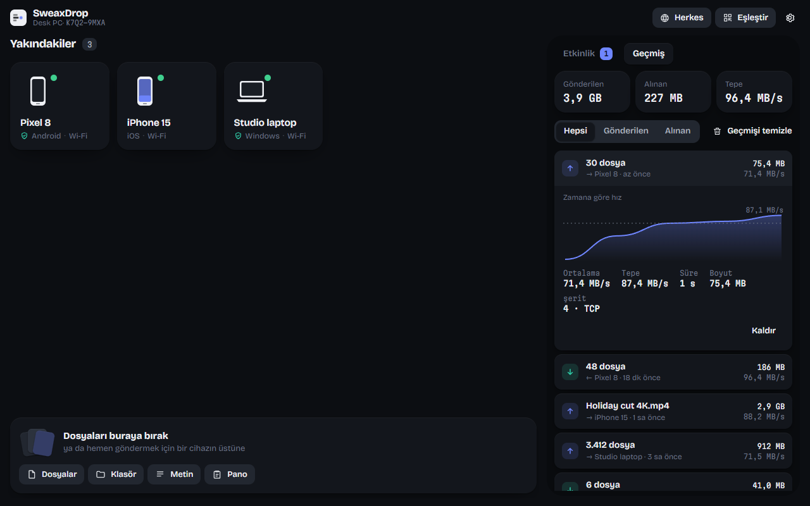
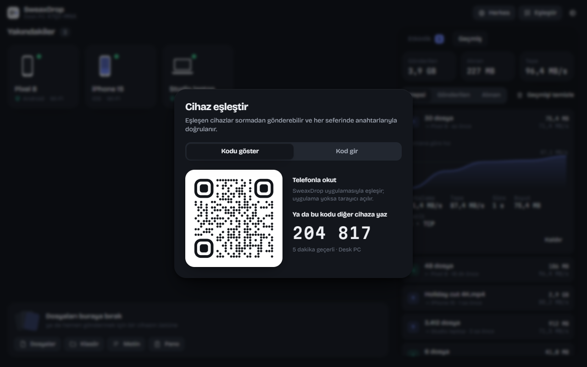
</div>

<div align="center">
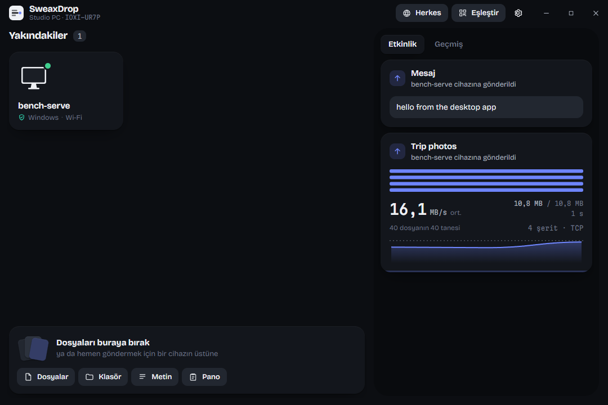
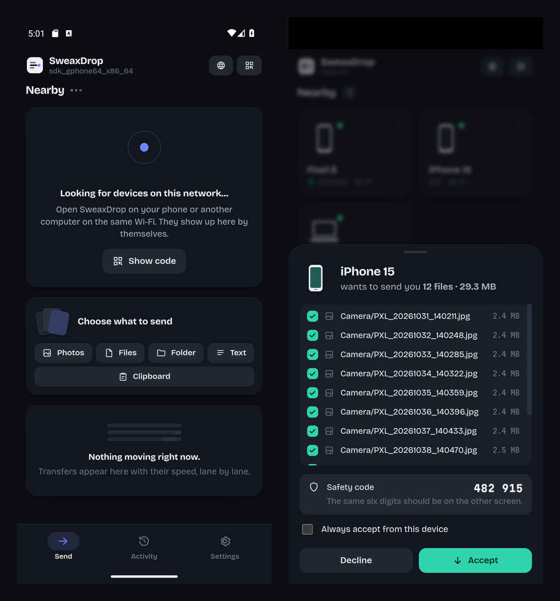
<br><sub>Gerçek uygulamalar: <code>tools/smoke-desktop.mjs</code> ile sürülen Windows sürüm derlemesi ve emülatördeki Android derlemesi. Karttaki hız, 40 küçük fotoğrafın yeni bir klasöre soğuk ilk aktarımıdır, ölçüm değildir; ölçülen sayılar <a href="#localsende-karşı-ölçüm">yukarıda</a>.</sub>
</div>

## Neden hızlı

<picture>
  <source media="(prefers-color-scheme: light)" srcset="docs/art/lanes-tr-light.svg">
  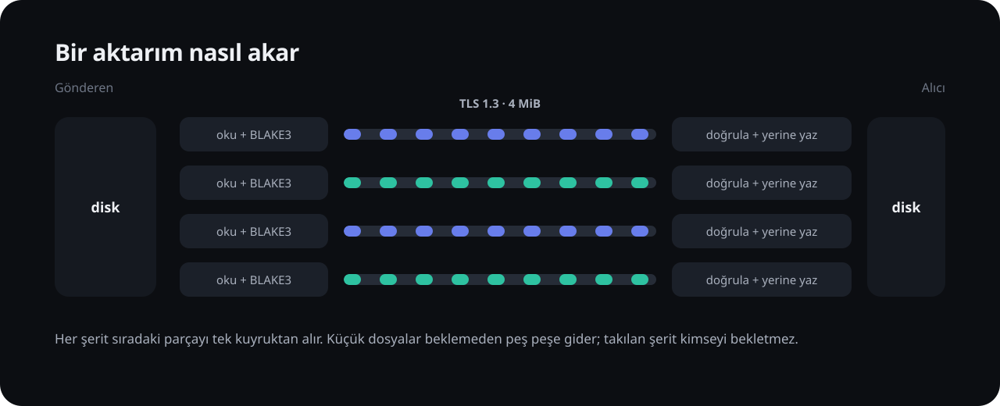
</picture>

* **Dosya başına istek yok.** Gönderen her şey için tek bir teklif yapar, sonra
  parçaları akıtır. Küçük dosyalar bir şeritte hiçbir cevap beklemeden peş peşe
  gider. Dosya başına istek yapan tasarımlar her fotoğraf için bir gidiş-dönüş, bir
  istek başlığı ve bir cevap öder.
* **Tek kuyruk, çok şerit.** Her şerit kendi TLS 1.3 bağlantısıdır (kendi TCP tıkanıklık
  penceresi) ve sıradaki parçayı ortak kuyruktan alır; büyük bir dosya bütün
  şeritlere yayılır, yavaş bir şerit diğerlerini bekletmez.
* **Hiçbir şey birbirini beklemez.** Her şeritte bir okuyucu iş parçacığı sıradaki
  parçayı okuyup hash'lerken ağ görevi bir öncekini şifreleyip gönderir; alıcıda
  bir yazıcı iş parçacığı parçayı hash'leyip yerine yazarken sıradaki çözülür. Biten
  dosyaları kapatıp yeniden adlandırmak (antivirüsün beklettiği yer) ayrı bir
  havuzda çalışır.
* **İkinci bir okuma olmadan bütünlük.** BLAKE3 her parçada akış sırasında, çekirdek
  başına saniyede birkaç GB hızla çalışır. Aktarım başlamadan önce "bütün dosyayı
  hash'le" adımı yoktur.
* **Ölçülerek verilmiş kararlar.** QUIC yerleşik, ama Windows'ta aynı loopback
  testinde yaklaşık 200 MB/s'de kaldı ve TCP'nin beş katı işlemci harcadı; bu yüzden
  varsayılan TCP şeritleri ([sayılar](docs/benchmarks.md#tcp-or-quic)). AES-128-GCM
  önce gelir çünkü PC'lerde ve ARMv8 telefonlarda AES komutları var; ChaCha20 bir
  ayar.

<picture>
  <source media="(prefers-color-scheme: light)" srcset="docs/art/architecture-tr-light.svg">
  
</picture>

## Güvenlik

* **Kimlik bir anahtardır.** Her kurulum bir Ed25519 anahtarı üretir. Cihaz
  kimliği (`K7Q2-9MXA-L4TB-N8ZE`) bu anahtardan türetilir; başka bir cihaz onu
  sahiplenemez, çünkü kimlik TLS el sıkışmasında kanıtlanan anahtarla karşılaştırılır.
* **İki yönlü TLS 1.3.** İki taraf da sertifikasını sunar. Eşleşen cihazlar
  sabitlenir; eşleşmiş bir kimlik farklı bir anahtarla gelirse hiçbir şey
  gönderilmez. Keşif paketlerine asla güvenilmez, yalnız nereye bağlanılacağını
  söylerler.
* **Araya girenin taklit edemeyeceği eşleştirme.** PIN eşleştirmesi TLS bağlantısı
  üzerinden SPAKE2 çalıştırır, sonra ortak anahtarı *iki* TLS parmak izinin üzerine
  bir MAC ile kanıtlar. Bağlantıyı aktaran biri her tarafta farklı anahtar görür,
  MAC'ler tutmaz. Yanlış PIN yalnız çevrimiçi, beş kez denenebilir. QR eşleştirmesi
  kodu gösteren cihazın parmak izini ve tek kullanımlık bir sırrı taşır.
* **İlk aktarımdan önce** eşleşmemiş bir cihazla iki ekran da karşılaştırmak için
  altı haneli bir güvenlik kodu gösterebilir.
* **Gelince doğrulanır.** Her parça yazılmadan önce doğrulanır (BLAKE3). Ağdan gelen
  yollar temizlenir: `..` yok, sürücü harfi yok, Windows'un ayırdığı adlar yok.
* **İstisna tarayıcı istemcisidir.** Tarayıcılar PC'nin kendinden imzalı
  sertifikasını bir uyarı sayfası olmadan kabul edemez; bu yol ağında düz HTTP'dir,
  QR koddaki 128 bitlik sır ve oturum başına anahtarlarla korunur. İhtiyacın yoksa
  Ayarlar'dan kapat.
* **Hiçbir şey ağından çıkmaz.** Hesap yok, aktarma sunucusu yok, telemetri yok.

Protokolün tamamı [docs/protocol.md](docs/protocol.md)'de.

## Kurulum

### Windows 10 ve 11

1. [Son sürümden](https://github.com/Sweax3169/sweaxdrop/releases/latest)
   `SweaxDrop-1.0.0-Windows-Setup.exe` dosyasını indir.
2. Çalıştır. Windows bir kez yönetici izni ister (UAC): kurulum, telefonların
   ulaşabilmesi için `sweaxdrop.exe` için tek bir gelen trafik güvenlik duvarı kuralı
   ekler, kaldırıcı onu siler. Uygulamanın kendisi güvenlik duvarı ayarlarına asla
   dokunmaz.
3. Kurulum dosyası kod imzalı olmadığı için SmartScreen uyarabilir. Dosya bu deponun
   sürümlerinden geldiyse *Ek bilgi → Yine de çalıştır*'ı seç (`SHA256SUMS.txt` ile
   karşılaştırabilirsin).

Kurulumdan sonra Gezgin'in sağ tık menüsünde *Gönder → SweaxDrop* görünür.

### Android 10 ve üstü

1. Telefonda [son sürümden](https://github.com/Sweax3169/sweaxdrop/releases/latest)
   `SweaxDrop-1.0.0-Android.apk` dosyasını indir.
2. Aç. Android tarayıcından uygulama yüklemeye izin vermeni ister; bu kurulum için
   izin ver.
3. SweaxDrop'u aç ve bildirimlere izin ver (ilerleme ve gelen dosyalar).

## iPhone

### Hemen, hiçbir şey kurmadan

1. PC'de SweaxDrop'u aç ve **Eşleştir**'e (ya da boş listedeki QR koda) tıkla.
2. iPhone kamerasını QR koda tut ve bağlantıya dokun.
3. Safari SweaxDrop'u açar. PC'ye fotoğraf ve dosya gönder ya da PC'nin gönderdiğini
   al. Gelen bir fotoğrafı saklamak için üstüne basılı tut, sonra *Fotoğraflar'a
   Kaydet*. Diğer dosyalar Dosyalar uygulamasına gider.

### Yerel uygulama

Apple bir iPhone'a yalnız o cihaz için imzalanmış uygulamaların girmesine izin verir
ve imzalamak bir Apple Kimliği ister. Bu deponun CI'ı uygulamayı bir macOS
makinesinde imzasız derler (`SweaxDrop-1.0.0-iOS-unsigned.ipa`); sen onu bir yan
yükleme aracıyla kendi Apple Kimliğinle imzalayıp kurarsın. Apple Kimliğin ve
şifren yalnız o aracın içindeki Apple girişine, kendi PC'nde yazılır.

**Ücretsiz Apple Kimliğiyle** (uygulama 7 gün sonra sona erer, yenilenmesi gerekir;
en çok 3 yan yüklenmiş uygulama):

1. PC'ne [AltServer](https://altstore.io) kur (Apple'ın sitesinden iTunes ve
   Windows için iCloud ister, Microsoft Store sürümleri değil) ya da
   [Sideloadly](https://sideloadly.io) kullan.
2. iPhone'u kabloyla bağla ve bilgisayara güven.
3. **AltStore:** AltServer'ın tepsi menüsünden telefona AltStore'u kur, sonra
   `.ipa`'yı AltStore'da aç. **Sideloadly:** `.ipa`'yı Sideloadly'ye sürükle ve
   Start'a bas.
4. iPhone'da: *Ayarlar → Genel → VPN ve Aygıt Yönetimi*, Apple Kimliğinin geliştirici
   profiline güven. iOS 16 ve üstünde ayrıca *Ayarlar → Gizlilik ve Güvenlik →
   Geliştirici Modu*'nu aç ve yeniden başlat.
5. 7 gün dolmadan uygulamayı yenile (AltStore bunu Wi-Fi üzerinden yapabilir).

**Ücretli Apple Developer hesabıyla** (yıllık 99 USD) aynı araçlar bir yıllığına
imzalar; proje bir Mac'te doğrudan Xcode'dan derlenip kurulabilir
(`apps/ios/project.yml`, XcodeGen ile üretilir).

İlk açılışta uygulama *Yerel Ağ* erişimi (PC'yi bulmak için) ve fotoğraf aldığında
onları kitaplığına ekleme izni ister.

## Kullanım

* **Gönder:** dosyaları bir cihazın üstüne sürükle ya da dosya, klasör, fotoğraf,
  metin veya pano seçip bir cihaza tıkla. Android'de herhangi bir uygulamadan
  *Paylaş → SweaxDrop ile gönder*. Windows'ta Gezgin'de *Gönder → SweaxDrop*.
* **Al:** kimin ne gönderdiğini gösteren bir pencere açılır; eşleşmemiş cihazlar için
  güvenlik kodu vardır. İstemediğin dosyaların işaretini kaldır, başka bir klasör
  seç ya da *Bu cihazdan her zaman kabul et*'i işaretle.
* **Eşleştir:** bir cihazda *Eşleştir → Kodu göster*, diğerinde *Kod gir* (ya da
  okut). Eşleşen cihazlarda bir kalkan görünür.
* **Listede cihaz yok mu?** İkisi de aynı ağda olmalı. *Eşleştir → Kod gir → Adresle
  ekle* IP ile bağlanır. Telefon erişim noktası ya da USB bağlantısı da çalışır.
* **Ayarlar:** herkesten, yalnız eşleşenlerden ya da kimseden alma; kayıt klasörü;
  eşleşen cihazları otomatik kabul; gelen metni panoya kopyalama; tarayıcı istemcisi;
  Windows ile başlat; şerit, parça boyutu, taşıma, şifre; tema, renkler, dil.

## Diğer araçlarla karşılaştırma

Her hücrenin kaynağı [docs/research.md](docs/research.md)'de.

| | SweaxDrop | LocalSend 1.18 | KDE Connect | Warpinator | PairDrop | Quick Share | croc |
|---|---|---|---|---|---|---|---|
| Taşıma | TCP şeritleri, TLS 1.3 (QUIC isteğe bağlı) | HTTPS, dosya başına bir istek | TCP + TLS, dosya başına yeni bağlantı | TLS üzerinden gRPC | WebRTC veri kanalı | TCP üzerinde protobuf, erişim noktası / Wi-Fi Direct'e geçer | TCP, aktarıcı ya da doğrudan |
| Aynı anda | 16 şeride kadar herhangi bir dosyanın parçaları | 2 dosya | 1 dosya | 1 dosya | 1 dosya, her 1 MB'de onay | 1 yük | 1 dosyanın parçaları, 4 bağlantıya kadar |
| Kopunca devam | evet, son doğrulanan parçadan | hayır, dosya baştan | bulunamadı | hayır, yarım dosyalar silinir | bulunamadı | uygulamada bulunamadı | evet |
| Karşıdaki kim | TLS'te kanıtlanan anahtar, eşleşince sabit | keşifte sabitlenen parmak izi | eşleşince sabit | ortak grup kodu (varsayılan "Warpinator") | sinyal sunucusuna güvenilir | UKEY2 + 4 haneli PIN | kod ifadesi (PAKE) |
| Aktarımdan önce hash | hayır, akış sırasında parça başına | evet, her dosyanın SHA-256'sı | hayır | hayır | hayır | hayır | hayır |
| Uygulamasız telefon | PC'den tarayıcı istemcisi | web paylaşım bağlantısı | hayır | hayır | kendisi bir site | hayır | hayır |

## Kaynaktan derleme

Rust (stable), Node.js 20+ ve her platformun kendi SDK'sı gerekir.

```bash
git clone https://github.com/Sweax3169/sweaxdrop && cd sweaxdrop
cd ui && npm ci && npx vite build && cd ..          # ortak arayüz
cargo test -p sweaxdrop-core                        # aktarım, devam, eşleştirme testleri
```

* **Windows:** `cd apps/desktop && npm ci && npx tauri build` → `target/release/bundle/nsis/`
* **Android:** NDK kuruluyken
  `cargo ndk -t arm64-v8a -t x86_64 -P 29 -o apps/android/app/src/main/jniLibs build --release -p sweaxdrop-ffi`,
  sonra `cd apps/android && ./gradlew assembleRelease`
* **iPhone (Mac'te):** `cargo build --release --target aarch64-apple-ios -p sweaxdrop-ffi`,
  `libsweaxdrop.a`'yı `apps/ios/lib`'e, `ui/dist`'i `apps/ios/ui`'ya kopyala, sonra
  `cd apps/ios && xcodegen generate` ve `SweaxDrop.xcodeproj`'yi aç
  ([CI aynısını yapar](.github/workflows/build.yml)).
* **Ölçümler:** `cargo build --release -p sweaxdrop-bench`, sonra
  `sweaxdrop-bench matrix` ya da `tools/run_benchmarks.sh`.

## Proje yapısı

```
crates/core     protokol: kimlik, TLS, keşif, eşleştirme, şeritler, devam, tarayıcı istemcisi
crates/ffi      çekirdeğin Android (JNI) ve iOS (C ABI) kütüphanesi
crates/bench    sweaxdrop-bench: loopback, cihaz ve LocalSend ölçümleri
apps/desktop    Windows uygulaması (Tauri 2): tepsi, Gönder menüsü, sürükle-bırak, kurulum kancaları
apps/android    Android uygulaması (Kotlin): WebView, MediaStore, paylaşım hedefi, servis
apps/ios        iPhone uygulaması (Swift): WKWebView, Fotoğraflar, Dosyalar, Bonjour
ui              her platformun gösterdiği arayüz (Svelte 5)
docs            web sitesi, protokol, araştırma, ölçümler, görseller
tools           video kaydedici, ölçüm sürücüleri, görsel üretici
```

## SSS

**İnternet gerekir mi?** Hayır. Her şey yerel ağında olur.

**Neden LocalSend değil?** İyi bir araç. SweaxDrop, LocalSend'in tasarımının zaman
kaybettirdiği yerlerde (dosya başına istek, aynı anda iki dosya, başlamadan her
şeyi hash'lemek, kaldığı yerden devam yok) daha hızlı olmak ve cihazları anahtarla
sabitlemek için var. [Sayılara](#localsende-karşı-ölçüm) bak.

**Telefon erişim noktası ya da USB kablosuyla çalışır mı?** Evet. İki cihazın
paylaştığı herhangi bir ağ çalışır; bir cihaza birden çok yoldan ulaşılabiliyorsa USB
ve erişim noktası adresleri önce denenir.

**Gelen dosyalar nereye gider?** Windows: `İndirilenler\SweaxDrop` ya da seçtiğin
klasör. Android: fotoğraf ve videolar galeriye (`Pictures/SweaxDrop`,
`Movies/SweaxDrop`), gerisi `Download/SweaxDrop`'a ya da seçtiğin klasöre. iPhone:
Fotoğraflar ve Dosyalar uygulamasında *iPhone'umda › SweaxDrop*.

**İki PC arasında da çalışır mı?** Evet, SweaxDrop çalıştıran herhangi iki cihaz.

## Lisans

MIT, bkz. [LICENSE](LICENSE). Yazı tipleri: Bricolage Grotesque ve Martian Mono (SIL
Open Font License). Üçüncü taraf paketler kendi lisanslarını korur; bkz.
[THIRD_PARTY_NOTICES.md](THIRD_PARTY_NOTICES.md).

[Sweax Studios](https://github.com/Sweax3169) yapımı.
